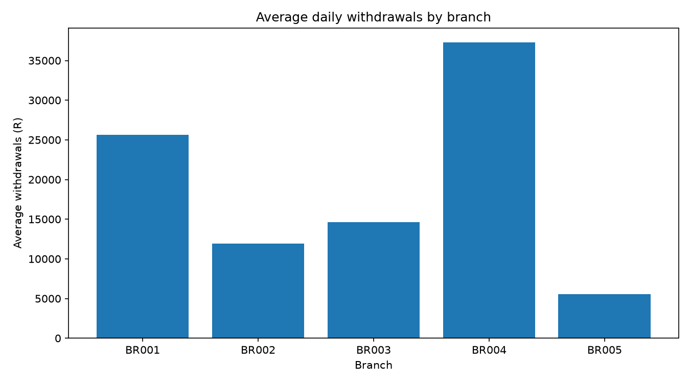

# BankPulse — Branch Cash Demand & Liquidity Intelligence

**A synthetic-data banking analytics project built with core statistics, probability, Bayesian inference, mathematical modelling and object-oriented Python.**

BankPulse helps a retail bank answer a practical operational question:

> How much cash should each branch hold tomorrow so that it can meet customer withdrawals without keeping excessive idle cash?

The project simulates daily branch cash withdrawals and deposits, studies demand patterns, estimates uncertainty, updates demand beliefs with Bayesian inference, and evaluates reserve policies under normal and stressed conditions.

This is an educational portfolio project. It is **not** a production liquidity-risk model, a regulatory capital model, or investment advice.

---

## Why a bank might care

Branches need enough cash to serve customers. Too little cash can cause failed withdrawals and reputational damage. Too much cash creates avoidable holding, insurance, transport and security costs.

BankPulse makes this trade-off measurable using:
- historical demand summaries and visual analysis;
- probability distributions for daily withdrawals;
- confidence intervals and bootstrap uncertainty;
- a Beta–Binomial Bayesian update for unusually high-demand days;
- a simple trend model using least squares;
- Monte Carlo stress scenarios;
- reserve-policy comparison using service level and estimated cost.

## What is included

| File | Purpose |
|---|---|
| `main.py` | Runs the complete analysis |
| `generate_data.py` | Reproducibly creates synthetic branch-day data |
| `bankpulse/analysis.py` | Descriptive statistics, confidence intervals and regression |
| `bankpulse/bayes.py` | Beta–Binomial Bayesian updating |
| `bankpulse/simulation.py` | Monte Carlo demand and reserve-policy simulation |
| `bankpulse/models.py` | OOP domain objects for branches and reserve policies |
| `bankpulse/reporting.py` | Charts and summary report |
| `bankpulse/config.py` | Central project settings |
| `tests/test_core.py` | Basic automated tests |
| `data/branch_daily.csv` | Generated dataset (created by `generate_data.py`) |
| `outputs/` | Charts and report (created when you run the project) |

## Concepts demonstrated

- **Introductory statistics:** mean, median, standard deviation, quartiles, percentiles and correlation.
- **Probability:** event probabilities, conditional scenarios and simulation.
- **Distribution theory:** Poisson withdrawal counts, normal approximation and empirical distributions.
- **Statistical inference:** confidence intervals and bootstrap intervals.
- **Bayesian inference:** Beta prior updated with observed high-demand days.
- **Statistical programming:** NumPy and pandas for reproducible analysis.
- **Mathematical modelling:** trend model and cash-reserve cost function.
- **Linear algebra:** least-squares regression estimated with `numpy.linalg.lstsq`.
- **Calculus:** marginal change in reserve holding cost and a numerical sensitivity calculation.
- **Data structures:** dictionaries, lists, arrays and tabular data.
- **OOP / software design:** separate classes, modules, configuration and testable functions.

The project deliberately avoids deep learning, complex credit scoring, external APIs and advanced frameworks.

---

## Quick start (Windows / PowerShell)

Open PowerShell in the extracted `BankPulse` folder.

### 1. Create a virtual environment (recommended)

```powershell
py -m venv .venv
.\.venv\Scripts\Activate.ps1
```

If PowerShell blocks activation, use:

```powershell
.\.venv\Scripts\python.exe -m pip install -r requirements.txt
```

### 2. Install dependencies

```powershell
python -m pip install -r requirements.txt
```

### 3. Generate the synthetic data

```powershell
python generate_data.py
```

### 4. Run the analysis

```powershell
python main.py
```

The report and figures will be saved in `outputs/`.

### 5. Run tests

```powershell
python -m unittest discover -s tests -v
```

## Dataset design

The generated dataset contains one row per branch per day. It includes:
- branch identifier and region;
- date and day of week;
- simulated customer withdrawal count;
- total withdrawal amount;
- total deposit amount;
- net cash outflow;
- a high-demand indicator.

The dataset is synthetic and generated with a fixed random seed. It is designed to illustrate methods, not to represent actual South African bank data.

## Model design and assumptions

### 1. Withdrawal demand

Daily withdrawal counts are generated from a Poisson distribution with a branch-specific intensity adjusted for weekday and month-end effects. Individual withdrawal sizes are simulated from a right-skewed lognormal distribution.

### 2. Cash reserve policy

For each branch, a reserve is selected from a historical demand percentile. The simulation estimates:
- probability that demand exceeds the reserve;
- average shortfall when demand exceeds the reserve;
- average excess cash left over;
- a simplified total cost.

The cost model is intentionally transparent:

`total_cost = shortfall_cost_rate * shortfall + holding_cost_rate * excess_cash`

The cost rates are illustrative assumptions, not real bank prices.

### 3. Bayesian high-demand monitoring

A branch-specific 80th-percentile threshold is calculated using the first half of the dates. The second half is then checked against that fixed threshold. A Beta prior is updated using only those later observations:

`posterior = Beta(alpha + high_days, beta + normal_days)`

The posterior mean estimates the probability of a high-demand day. The credible interval represents uncertainty about that probability.

### 4. Least-squares trend

A simple linear trend is estimated using the normal least-squares solution through `numpy.linalg.lstsq`. The model is intentionally small and interpretable. It is not a sophisticated forecasting system.

### 5. Uncertainty

The project reports a confidence interval for mean daily withdrawals and a bootstrap interval for the mean. These quantify sampling uncertainty under the simulated data assumptions; they do not remove model risk.

---

## Technology

- Python 3.10+
- NumPy
- pandas
- Matplotlib

No internet connection or paid API is required after dependencies are installed.
## Project Visualisation

### Branch Comparison


