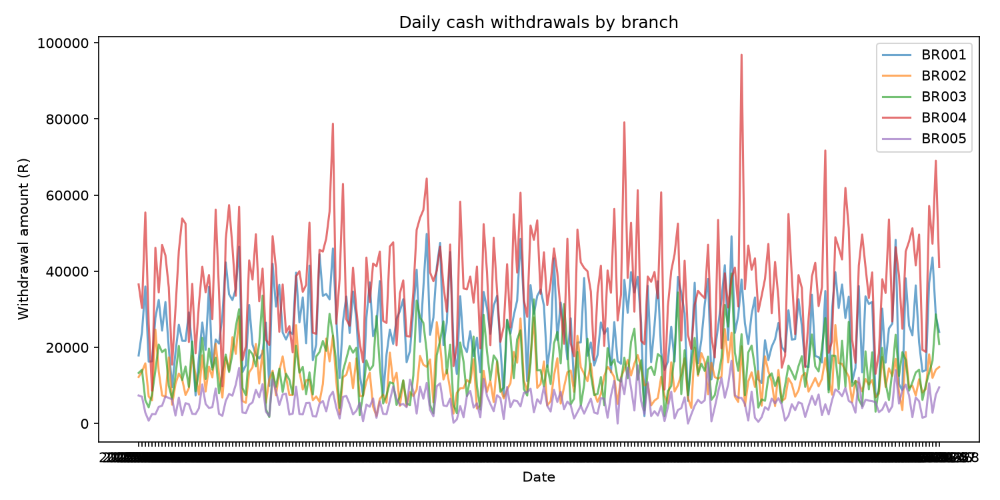
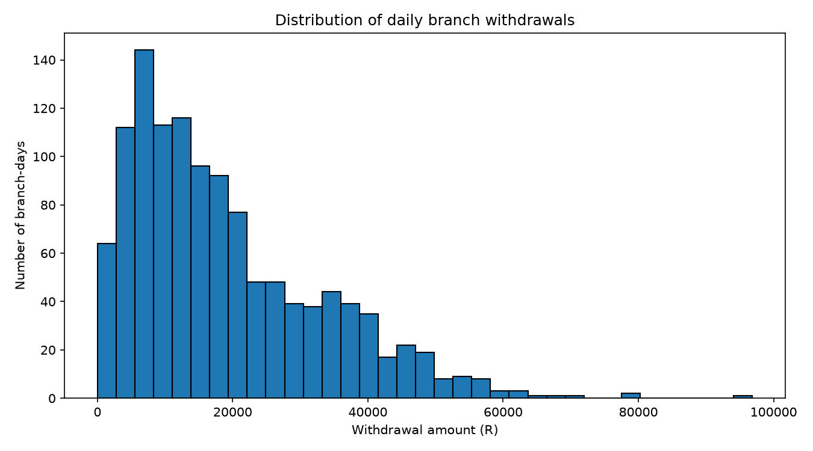

# BankPulse — Branch Cash Demand & Liquidity Intelligence

A Python-based banking analytics project that uses synthetic data, statistical inference, Bayesian modelling and Monte Carlo simulation to investigate cash demand and branch reserve allocation.

## The Banking Problem

How much cash should each branch hold to meet customer withdrawals without keeping excessive idle cash?

Insufficient reserves can result in failed withdrawals, while excessive reserves create avoidable holding, insurance, transport and security costs.

BankPulse investigates this trade-off through statistical analysis and simulation.

## What the Project Does

- Generates reproducible synthetic daily withdrawal and deposit data for multiple branches.
- Analyses withdrawal patterns using descriptive statistics and probability distributions.
- Estimates uncertainty using confidence intervals and bootstrap resampling.
- Applies Beta–Binomial Bayesian updating to estimate high-demand probabilities.
- Uses least-squares regression to examine demand trends.
- Simulates cash-demand scenarios using Monte Carlo methods.
- Compares reserve policies using estimated shortages, excess cash and illustrative costs.

## Statistical and Technical Methods

- **Descriptive statistics:** Mean, median, standard deviation, quartiles and percentiles.
- **Probability and distributions:** Poisson, normal approximation, lognormal and empirical distributions.
- **Statistical inference:** Confidence intervals and bootstrap intervals.
- **Bayesian inference:** Beta–Binomial updating.
- **Mathematical modelling:** Demand trends and cash-reserve cost functions.
- **Linear algebra:** Least-squares estimation using `numpy.linalg.lstsq`.
- **Calculus:** Marginal changes in holding costs and numerical sensitivity.
- **Simulation:** Monte Carlo scenarios for reserve-policy evaluation.
- **Software design:** Object-oriented programming, modular code and automated tests.

## What I Realised

Building BankPulse helped me understand that cash management is not simply about predicting average withdrawals. It is about making decisions under uncertainty.

A branch can experience demand above its average, and a reserve policy that ignores this variability may be inadequate. I realised that statistical inference, Bayesian updating and simulation can work together to evaluate uncertainty and compare operational decisions.

I also learned that a reserve policy must balance two competing risks: insufficient cash and the cost of holding excess cash.

## Technologies

Python 3.10+, NumPy, pandas and Matplotlib.

## Project Structure

- `main.py` — Runs the analysis.
- `generate_data.py` — Generates synthetic data.
- `bankpulse/` — Analysis, Bayesian modelling, simulation, reporting and configuration modules.
- `tests/` — Automated tests.
- `data/` — Generated dataset.
- `outputs/` — Charts and reports.

## Run the Project

```bash
python -m pip install -r requirements.txt
python generate_data.py
python main.py
python -m unittest discover -s tests -v
```

Outputs are saved in `outputs/`.

## Data and Limitations

All data is synthetic and does not represent actual South African bank data. Cost rates and model assumptions are illustrative. This is an educational prototype, not a production liquidity-risk or regulatory model.

---

## Project Visualisation

The following visualisations present the analytical outputs generated by BankPulse.

<table>
  <tr>
    <td width="50%" align="center">
      <strong>Branch Comparison</strong><br><br>
      
      <p><sub>Comparison of average daily cash withdrawals across five bank branches.</sub></p>
    </td>
    <td width="50%" align="center">
      <strong>Daily Withdrawal Trends</strong><br><br>
      
      <p><sub>Daily cash withdrawal patterns across branches over the simulation period.</sub></p>
    </td>
  </tr>
  <tr>
    <td width="50%" align="center">
      <strong>Withdrawal Distribution</strong><br><br>
      
      <p><sub>Distribution of daily withdrawal amounts and their variability.</sub></p>
    </td>
    <td width="50%" align="center">
      <strong>Statistical Report</strong><br><br>
      <p>📄 Detailed numerical and statistical results generated by the project.</p>
      <a href="outputs/bankpulse_report.txt">View Full Statistical Report</a>
    </td>
  </tr>
</table>

---

## Statistical Analysis

The generated report contains:

- Branch-level descriptive statistics.
- Bayesian high-demand monitoring.
- Posterior parameter estimates.
- Cash reserve policy simulation.
- Shortfall probabilities and reserve comparisons.

## Data & Reproducibility

All figures and results are based on synthetically generated educational data.

The visualisations and statistical reports are generated programmatically using Python and scientific computing libraries.

---

Copyright © 2026 Mohale Tomanyana. All rights reserved.

This project was developed by Mohale Tomanyana for educational and portfolio purposes.
